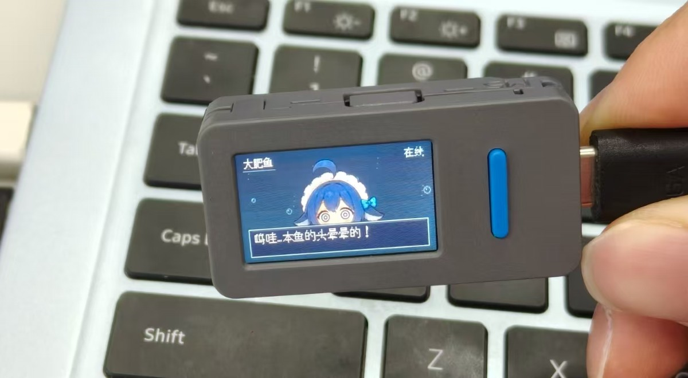
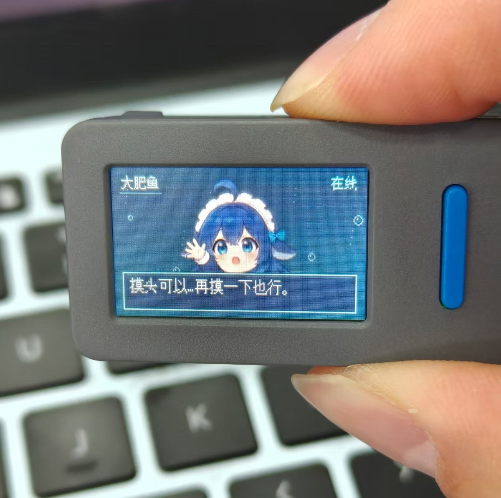
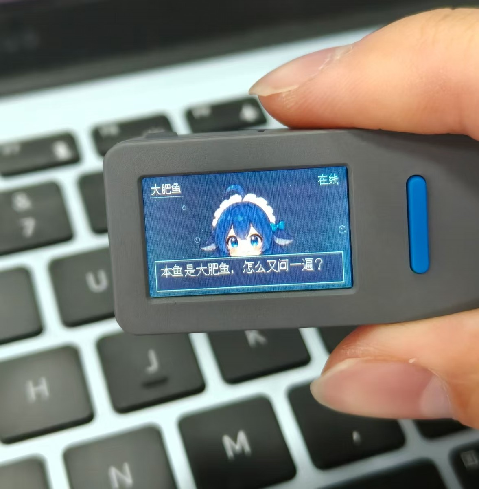

# 大肥鱼 · StickS3 桌宠

大肥鱼是一只住在 M5Stack StickS3 小屏幕里的鲸鱼娘。单独供电时，可以摸头、摇晃设备、倒置屏幕，或者看它打盹。通过 USB 连到电脑后，还能按键进行语音对话、记住你交代的事，并显示编程任务的进度提示。



<p>
  
  
</p>

## 操作方式

| 操作 | 效果 |
| --- | --- |
| 短按 B 键 | 摸头，触发表情 |
| 长按 B 键约 0.7 秒 | 切换勿扰。手动发起的语音对话仍会出声 |
| 轻晃或倒置设备 | 触发头晕表情或翻转角色。开机时请保持日常摆放姿势，作为方向参考 |
| 静置约 3 分钟 | 进入打盹状态 |
| 按住正面 A 键，松开提交 | 录制最多 12 秒的语音，需要运行电脑端服务 |

连接电脑后，默认空闲约 20 分钟会主动搭话。主动搭话每三次最多出声一次，两次主动语音至少间隔一小时。电脑本地时间 23:00 至 07:00 静音。

## 烧录固件

准备一块 M5Stack StickS3、一根支持数据传输的 USB 线，以及装有 PowerShell 的 Windows 电脑。[StickS3 硬件文档](https://docs.m5stack.com/en/core/StickS3)

1. 安装 Arduino CLI 并加入 `PATH`，或将 `arduino-cli.exe` 放入项目的 `.arduino/bin/`。推荐使用已验证的 1.6.0 版本。[Arduino CLI 安装说明](https://docs.arduino.cc/arduino-cli/installation)
2. 在项目根目录运行以下命令。首次执行 `Setup` 会下载 ESP32 开发板包 3.3.10-cn、M5Unified 0.3.0 和 M5GFX 0.3.0。

   ```powershell
   .\arduino.ps1 -Action Setup
   .\arduino.ps1 -Action Ports
   .\arduino.ps1 -Action Compile
   .\arduino.ps1 -Action Upload -Port COM6
   ```

3. 将 `COM6` 换成设备实际串口，上传前关闭占用该串口的程序。若设备未进入下载模式，接上 USB 后按住侧面复位键，等绿灯闪烁后松开。[StickS3 下载模式](https://docs.m5stack.com/en/core/StickS3#download-mode)

编译产物位于 `.build/WhaleMate/`。想单独编译旧示例，可以运行 `.\arduino.ps1 -Action Compile -Sketch HelloQoder`。

## 启动电脑端服务

在 Windows 上安装 Python，本项目使用 Python 3.13 验证。先用模拟模式检查录音、字幕和扬声器。松开 A 键后，设备应显示模拟回复，并播放提示音。

```powershell
python -m venv .venv
.\.venv\Scripts\python.exe -m pip install -r host\requirements.txt
.\.venv\Scripts\python.exe host\whalemate.py serve --port COM6 --mock-voice
```

使用真实语音时，先在当前 PowerShell 会话中设置 `DEEPSEEK_API_KEY`，再去掉 `--mock-voice` 启动。密钥需有权调用代码使用的 DeepSeek 语音识别、对话和语音合成接口。可用 `WHALE_MODEL` 指定对话模型，默认值为 `deepseek-flash`。

如果密钥已经保存在 Windows 用户环境变量里，可以在当前窗口重新读取。

```powershell
$env:DEEPSEEK_API_KEY = [Environment]::GetEnvironmentVariable('DEEPSEEK_API_KEY', 'User')
.\.venv\Scripts\python.exe host\whalemate.py serve --port COM6
```

真实语音模式会将按键录制的音频发给 DeepSeek 进行识别，再将转写文字、近期对话及长期记忆发给对话接口。电脑端处理完音频后会丢弃它，并将近期对话和长期记忆保存在本机。

### 编程事件

服务运行时，在另一个 PowerShell 窗口发送模拟事件。等待批准会显示字幕，在未开启勿扰且处于非静音时段时也会播放短提示音。

```powershell
.\.venv\Scripts\python.exe host\whalemate.py event completed --project StickS3
.\.venv\Scripts\python.exe host\whalemate.py event failed --project StickS3
.\.venv\Scripts\python.exe host\whalemate.py event approval --project StickS3
```

其他工具可以向本机的 `POST http://127.0.0.1:8723/event` 提交 JSON，例如 `{"kind":"completed","project":"StickS3"}`。事件分别对应完成、失败和等待批准。

### 本地记忆

服务最多保存最近六轮对话，也会提取“记住”“记一下”“别忘”等明确交代的内容。数据库位于 `.whalemate/memory.sqlite3`。

```powershell
.\.venv\Scripts\python.exe host\whalemate.py memory list
.\.venv\Scripts\python.exe host\whalemate.py memory clear
```

`list` 只显示长期记忆。`clear` 会同时清除长期记忆和近期对话。

## 项目结构

| 路径 | 内容 |
| --- | --- |
| [WhaleMate/](WhaleMate/) | StickS3 主固件和生成好的角色贴图 |
| [host/](host/) | Python 串口服务、事件接收、本地记忆和单元测试 |
| [assets/](assets/) | 角色贴图条、转换脚本及素材署名 |
| [examples/HelloQoder/](examples/HelloQoder/) | 原有的独立示例 |
| [docs/photos/](docs/photos/) | 设备实拍 |
| [arduino.ps1](arduino.ps1) | Windows 下安装依赖、编译和烧录的入口 |

运行电脑端单元测试。

```powershell
.\.venv\Scripts\python.exe -m unittest discover -s host -v
```

替换贴图条后，可用装有 Pillow 的 Python 运行 `python assets/make_portraits.py`，重新生成固件贴图。

## 来源与署名

角色素材沿用上游的 CC BY-NC-SA 4.0 条款，电脑端记忆代码改编自上游 MIT 许可项目。详见 [角色素材署名](assets/NOTICE.md) 和 [记忆代码来源](host/NOTICE.md)。
